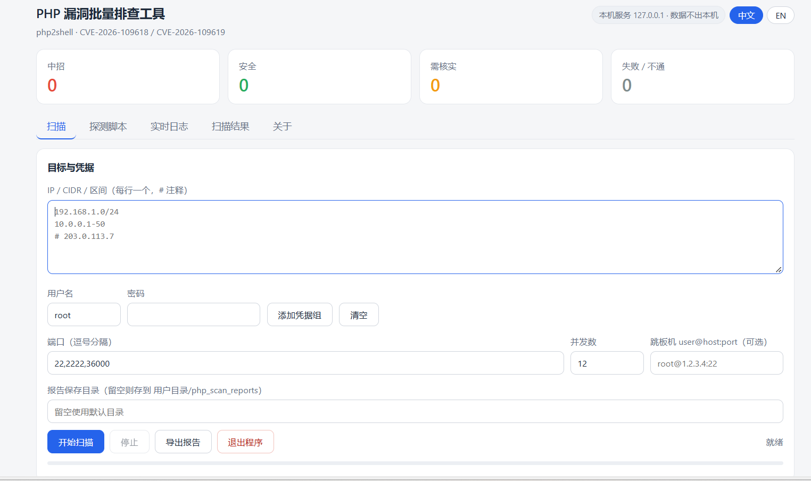

# phpscan — Bulk SSH PHP Inventory & Vulnerability Scanner

[English](#english) | [中文](#中文)

> A single-file, cross-platform desktop tool that audits **every PHP installation across a fleet of
> Linux servers over SSH** — including Docker containers and virtual-host bindings — and reports which
> ones are affected by **php2shell (CVE-2026-109618 / CVE-2026-109619)**.
>
> Ships as a local web app: run the binary, your browser opens, no Python/Node runtime needed.
> UI and reports are available in **English and Simplified Chinese**.

**Author:** Bian Chengxu（边承旭） · <bianqiang@gmail.com> · https://www.spark8.xyz
**Version:** 1.0.0 · **License:** MIT

<p align="center">
  
  <br><sub>主界面（中文） · Main UI — all sample IPs in the screenshot are documentation placeholders (RFC 1918 / RFC 5737)</sub>
</p>

---

## English

### Why this tool

Most php2shell scanners published so far probe a **website over HTTP** (version banners, OOM-triggered
probes, subdomain recon). That works for public sites with a domain name — and fails for the machines
you actually administer: internal hosts, virtual-host boxes with no public hostname, servers behind a
bastion, and PHP running inside containers.

`phpscan` takes the other path: it **logs in over SSH** and inventories the host directly.

|  | HTTP scanners | phpscan |
|---|---|---|
| Needs a public domain | Yes | No — SSH only |
| Works behind a bastion / jump host | No | Yes |
| Sees PHP inside Docker containers | No | Yes |
| Finds *all* PHP binaries on a host (`cli` / `fpm-fcgi` / `cgi-fcgi`) | No | Yes |
| Maps vhost → PHP version | No | Yes |
| Batch CIDR / IP ranges, multiple credential sets | n/a | Yes |
| GUI, live log, CSV/HTML/Markdown reports | varies | Yes |

### Features

- **Batch SSH inventory** — IP / CIDR / range (`10.0.0.1-50`), multiple ports, multiple credential sets
  (tried in order), configurable concurrency.
- **Bastion / jump host** support (`user@host:port`), dialed via SSH port forwarding.
- **Deep PHP discovery** — finds every `php`, `php-fpm*`, `php-cgi` binary on disk, plus packages
  (`dpkg`/`rpm`), plus PHP inside running Docker containers, plus the PHP version each nginx/Apache
  vhost is wired to.
- **Per-SAPI breakdown** — a host typically carries three PHP binaries with the same version but
  different roles; all three are listed, because patching only one leaves the others exposed.
- **Verdict per host** — `Vulnerable` / `Safe` / `Review` / `Failed`, with fixed-version guidance
  (8.2 → 8.2.35+, 8.3 → 8.3.36+, 8.4 → 8.4.27+, 8.5 → 8.5.12+; 8.1 and older are EOL).
- **Editable probe script** — the detection logic is a plain shell script you can rewrite in the UI.
  It is piped to the remote host over stdin and **never written to disk**, which also makes this a
  general-purpose "run a script across N hosts and collect the output" tool.
- **Reports** — CSV (Excel-safe BOM), HTML, and Markdown, in English or Chinese.
- **Bilingual** — UI, logs, and reports switch between English and Simplified Chinese.
- **Single file, zero runtime** — ~8 MB static binary for Windows / macOS (Intel + Apple Silicon) / Linux.

### Download & run

Grab the binary for your platform from [Releases](../../releases):

```bash
# macOS — remove the quarantine flag from the unsigned build
xattr -d com.apple.quarantine phpscan-darwin-arm64
chmod +x phpscan-darwin-arm64 && ./phpscan-darwin-arm64
```

```powershell
# Windows — just double-click phpscan-windows-amd64.exe
```

It starts a local server on `127.0.0.1:8787` and opens your browser automatically.
If the port is taken by a running instance, the new process reuses it instead of starting a second one.
Use the **Quit** button in the UI to stop the program (there is no console window on Windows).

Command line options:

| Flag | Effect |
|---|---|
| `--no-browser`, `-n` | Start the server without opening a browser |
| `--port=NNNN` | Listen on a specific port (default `8787`) |

### Build from source

Requires Go 1.21+ (no cgo, no external GUI/toolchain):

```bash
go build -ldflags "-s -w" -o phpscan .                        # current platform
GOOS=darwin  GOARCH=arm64 go build -ldflags "-s -w" -o phpscan-darwin-arm64 .
GOOS=linux   GOARCH=amd64 go build -ldflags "-s -w" -o phpscan-linux-amd64 .
```

Windows needs `-H windowsgui` to suppress the console window:

```bash
GOOS=windows GOARCH=amd64 go build -ldflags "-s -w -H windowsgui" -o phpscan-windows-amd64.exe .
```

`./build.sh` (macOS/Linux) and `build.bat` (Windows) build all four targets at once.
Pushing a `v*` tag runs the GitHub Actions workflow that publishes all four binaries to Releases.

### Privacy & safety

- The HTTP server binds to **`127.0.0.1` only** — it is not reachable from the network.
- Credentials are kept **in memory** and are never written to disk, logs, or reports.
- The probe script runs **read-only**; it executes `php -v` and reads config. It never upgrades,
  restarts, or modifies anything on the target.
- Reports are written only when you click *Export report*, into a folder you choose.
- SSH host keys are accepted without pinning (typical for internal fleet audits). If that is not
  acceptable in your environment, change `ssh.InsecureIgnoreHostKey()` in `main.go`.

### Project layout

```
main.go          HTTP server, SSH scan engine, report generation
i18n.go          English / Simplified Chinese message catalog
ui/index.html    Entire browser UI (embedded into the binary via go:embed)
```

### Disclaimer

This tool is intended for **defensive inventory and patch verification on systems you own or are
explicitly authorized to administer**. It performs no exploitation and no modification. It reports
version information only — an "Safe" verdict means "version is at or above the fixed release",
not a guarantee that a backport is present or that the running process was restarted after patching.
Always confirm against your vendor's advisory.

### License

MIT — see [LICENSE](LICENSE).

---

## 中文

### 为什么做这个

目前已公开的 php2shell 扫描器，几乎都是从**外网发 HTTP 请求**去探网站（版本 banner、OOM 触发、子域侦察）。
这种方式适合有域名公网站点，但解决不了运维真正管的机器：**内网主机、没有公网域名的虚拟主机、躲在堡垒机后面的
服务器、跑在 Docker 容器里的 PHP**。

`phpscan` 走另一条路：**直接 SSH 登录主机清点**。

|  | HTTP 扫描器 | phpscan |
|---|---|---|
| 需要公网域名 | 是 | 否，只要能 SSH |
| 支持堡垒机 / 跳板机 | 否 | 是 |
| 能查 Docker 容器里的 PHP | 否 | 是 |
| 找出主机上**全部** PHP 二进制（cli / fpm-fcgi / cgi-fcgi） | 否 | 是 |
| vhost → PHP 版本对应关系 | 否 | 是 |
| 批量 CIDR / IP 段、多组凭据 | 不适用 | 是 |
| 图形界面、实时日志、CSV/HTML/Markdown 报告 | 部分有 | 有 |

### 功能

- **批量 SSH 清点**：IP / CIDR / 区间（`10.0.0.1-50`）、多端口、多组凭据按顺序尝试、并发可调。
- **堡垒机 / 跳板机**（`user@host:port`），通过 SSH 端口转发连接内网机器。
- **深度发现 PHP**：全盘找出所有 `php` / `php-fpm*` / `php-cgi` 二进制，加上软件包（`dpkg` / `rpm`）、
  Docker 容器内的 PHP、以及 nginx/Apache 虚拟主机实际使用的 PHP 版本。
- **区分运行模式（SAPI）**：一台机上通常有三个同版本但用途不同的 PHP 二进制，全部列出——只升其中一个，
  另两个仍是中招版本。
- **逐台判定**：中招 / 安全 / 需核实 / 失败，并给出修复版本（8.2→8.2.35+、8.3→8.3.36+、8.4→8.4.27+、
  8.5→8.5.12+；8.1 及更早已 EOL）。
- **探测脚本可在线改**：检测逻辑就是一个 shell 脚本，界面里可随时重写。脚本经 stdin 喂给远端执行、
  **不在目标机落盘**——这也让它成为一台通用的"批量下发脚本并回收结果"工具。
- **报告**：CSV（带 BOM，Excel 直接打开不乱码）、HTML、Markdown，中英双语。
- **单文件、零运行时**：Windows / macOS（Intel + Apple 芯片）/ Linux 各约 8 MB 静态二进制。

### 下载运行

从 [Releases](../../releases) 取对应平台的二进制：

```bash
# macOS：未签名构建需先去掉隔离属性，或右键 → 打开
xattr -d com.apple.quarantine phpscan-darwin-arm64
chmod +x phpscan-darwin-arm64 && ./phpscan-darwin-arm64
```

```powershell
# Windows：双击 phpscan-windows-amd64.exe
```

程序会在 `127.0.0.1:8787` 起本地服务并自动打开浏览器；若端口已被本程序占用，新进程直接复用而不重复启动。
Windows 版没有控制台窗口，退出请点界面上的**「退出程序」**按钮。

命令行参数：

| 参数 | 作用 |
|---|---|
| `--no-browser`、`-n` | 启动但不自动开浏览器 |
| `--port=NNNN` | 指定端口（默认 `8787`） |

### 从源码构建

需要 Go 1.21+，纯 Go、无 cgo、无需任何 GUI 工具链：

```bash
go build -ldflags "-s -w" -o phpscan .                        # 当前平台
GOOS=darwin  GOARCH=arm64 go build -ldflags "-s -w" -o phpscan-darwin-arm64 .
GOOS=linux   GOARCH=amd64 go build -ldflags "-s -w" -o phpscan-linux-amd64 .
```

Windows 需加 `-H windowsgui` 以隐藏控制台黑框：

```bash
GOOS=windows GOARCH=amd64 go build -ldflags "-s -w -H windowsgui" -o phpscan-windows-amd64.exe .
```

`./build.sh`（macOS/Linux）与 `build.bat`（Windows）可一次构建四个平台。
推送 `v*` 标签会触发 GitHub Actions，自动打包四个二进制发布到 Releases。

### 隐私与安全

- HTTP 服务**只监听 127.0.0.1**，外部网络无法访问。
- 凭据**只存在内存**，不写磁盘、不进日志、不进报告。
- 探测脚本为**只读**：只执行 `php -v` 和读配置，绝不升级、重启或修改目标机任何东西。
- 只有你点「导出报告」时才写文件，目录由你指定。
- SSH 主机密钥未做固定校验（内网批量清点常见做法）。若你的环境不接受，请修改 `main.go` 里的
  `ssh.InsecureIgnoreHostKey()`。

### 目录结构

```
main.go          HTTP 服务、SSH 扫描引擎、报告生成
i18n.go          中英文文案表
ui/index.html    浏览器界面全部代码（通过 go:embed 编译进二进制）
```

### 免责声明

本工具仅用于**在自有或明确授权管理的系统上做防御性资产清点与补丁核验**，不做任何利用、不做任何修改。
它只报告版本信息——"安全"表示"版本不低于官方修复版"，不代表发行版回移补丁已生效、也不代表打补丁后
进程已重启。请以厂商公告为准复核。

### 许可证

MIT —— 见 [LICENSE](LICENSE)。

---

## 作者 / Author

**Bian Chengxu（边承旭）**

- 邮箱 Email：<bianqiang@gmail.com>
- 网站 Website：https://www.spark8.xyz

本工具以艺名 **Bian Chengxu** 署名发布。程序内「关于」页、CLI `--version` 横幅、以及导出的
HTML / Markdown 报告页脚，均会带上以上署名与联系方式。

欢迎反馈缺陷、提出功能建议或交流合作——直接发邮件即可。
